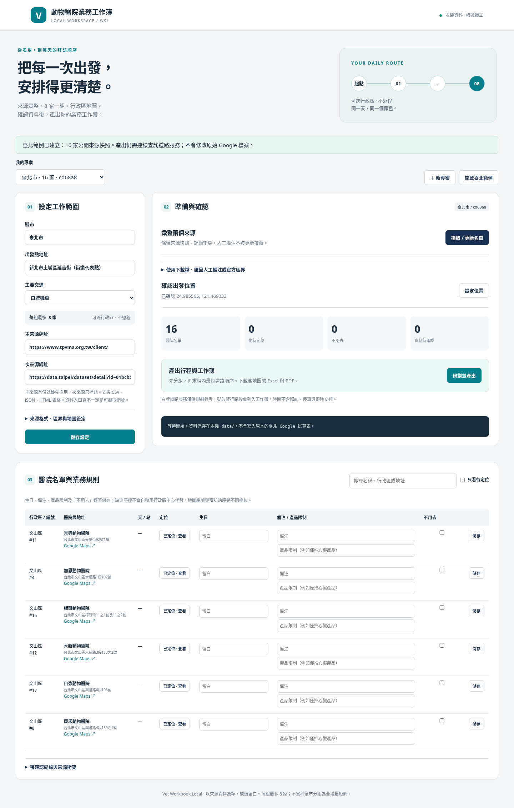

# 動物醫院業務工作簿 · Local / Windows WSL

把「只有院所名單、不知道在哪裡及怎麼跑」轉成分區地圖、每日拜訪分組與導航連結。

本 repository 是可執行的本機 Web UI 產品原始碼。Google Sheets 正式工作簿由另一套助理維護流程製作；本程式輸出 Excel／PDF，**沒有內建 Google Sheets 同步或雲端月排程**。完整範圍與案例成效見 [專案案例](docs/PROJECT_CASE.md)，上傳方式見 [GitHub 上傳指南](docs/GITHUB_UPLOAD.md)。




輸入縣市、出發地址、交通方式、主來源及次來源，透過本機網頁確認資料，產出 Excel 工作簿與地圖 PDF。每組最多 8 家、可跨區、不返程。本工具不需登入 ChatGPT，也不需要 OpenAI API key。

**版本 1.0.0。** Excel 內嵌圖片與原生 Google Maps 超連結；不會連線修改原本的臺北 Google 試算表。本版不是任意網站的全自動爬蟲，也沒有 Google Sheets 帳號同步。CSV/JSON/HTML 表格可設定欄位對應；JavaScript 網頁、驗證碼、登入站台需另寫 adapter 或使用正式下載檔。無法讀取時停止，不猜資料。

## 1. Windows WSL 安裝與啟動

建議 Windows 11 + WSL 2 + Ubuntu 24.04（Python 3.10+；已在 Linux/Python 3.12 驗證，未實機測試 Windows WSL）。

若尚未安裝 WSL，在 Windows 系統管理員 PowerShell 執行：

```powershell
wsl --install -d Ubuntu-24.04
```

重新啟動後建立 Ubuntu 帳號。在 Ubuntu 終端安裝必要套件：

```bash
sudo apt update
sudo apt install -y python3 python3-venv fonts-noto-cjk unzip
```

### 方式 A：可執行安裝包（推薦）

將 `vet-workbook-local-1.0.0.run` 下載到 Windows 的 Downloads。將下列 Windows 使用者名稱改成自己的：

```bash
bash '/mnt/c/Users/你的Windows使用者名稱/Downloads/vet-workbook-local-1.0.0.run'
bash ~/vet-workbook/run.sh
```

安裝包預設安裝到 `~/vet-workbook`；亦可傳入其他路徑：`bash ...run ~/apps/vet-workbook`。需連線下載 Python 相依套件。

### 方式 B：原始碼 ZIP

把 ZIP 解壓到 WSL 的 Linux 家目錄；避免直接在 `/mnt/c` 上大量讀寫快取：

```bash
cd ~
unzip '/mnt/c/Users/你的Windows使用者名稱/Downloads/vet-workbook-local-1.0.0.zip'
cd ~/vet-workbook
bash install.sh
bash run.sh
```

在 **Windows 瀏覽器**開啟 <http://localhost:8765>。保留 WSL 終端開啟，按 Ctrl+C 停止。只監聽 `127.0.0.1`，不開放區域網路。連不到時先在 WSL 執行 `curl http://localhost:8765` 檢查服務，再檢查 Windows 的 WSL localhost forwarding；不要直接改為公開監聽。

預設路徑安裝後，也可以雙擊套件中的 `start-windows.cmd`。若使用多個 WSL 發行版，修改其中的 `wsl.exe` 指令加上 `-d Ubuntu-24.04`。這不是 Windows 原生 `.exe`，是於 WSL 執行的本機程式。

## 2. 實際操作

1. **建立專案**：輸入縣市完整名稱、出發地址、交通方式、主來源與次來源網址。
2. **確認來源格式與完整性**：已內建臺北公會及指定臺北政府資料集 adapter。其他來源請打開進階設定。可先下載官方 CSV/JSON 再匯入；UTF-8 編碼，電話欄不要先被 Excel 轉成數字。
3. **擷取 / 更新名單**：檢視筆數、待確認與來源衝突。次來源獨有的機構保留於待確認，不擅自排入拜訪。來源無資料或筆數驟減逾 20% 時，停止且保留前次資料。
4. **確認定位**：來源如明列 WGS84 經緯度會保留其出處。其他醫院可逐筆搜尋候選、核對完整門牌後確認，或輸入官方座標。出發點也要確認。候選若只是道路/區中心不要採用。本版不會批次以不確定搜尋結果代替精確地址。
5. **業務規則**：勾選「不用去」、填寫產品限制、生日與備注，按該列「儲存」。產品限制只標紅、仍排入行程；本次不能推廣該品項時請另外勾「不用去」。原臺北的排除名單不自動套到其他專案。
6. **地圖**：可匯入該縣市官方行政區界 WGS84 GeoJSON，並填來源網址。未提供則明示沒有官方區界。街道底圖可選用 OpenStreetMap；服務失敗會標示為座標圖，不假裝有街道。
7. **規劃並產出**：使用有方向的道路距離矩陣、固定起點、不返程；可下載 Excel、PDF、成果 ZIP、驗證 JSON。待定位院所需先確認或明確設為不拜訪。

「開啟臺北範例」只載入 16 家已定位的公開資料快照，便於熟悉介面。它不是完整臺北名單；要製作當期完整資料請使用「擷取 / 更新名單」。範例道路仍會重新向線上服務查詢，未預設沿用舊路線。

## 3. 來源設定

支援自動辨識的欄位見 `vetapp/sources.py`。其中 `name`、`address` 必須有值；負責人只讀明確欄位，不從其他人名推論。地址若不含縣市，可由同一筆的明確 `city` / `縣市` 欄位組合；不能只因使用者選了某市就猜地址屬於該市。

通用完整 CSV / JSON：

```json
{
  "complete_confirmed": true,
  "mapping": {
    "name": "醫院名稱",
    "phone": "聯絡電話",
    "address": "地址",
    "owner": "負責人",
    "city": "縣市",
    "district": "行政區",
    "lat": "緯度",
    "lon": "經度"
  }
}
```

不需要的 mapping 欄位可以刪掉。**complete_confirmed 只能在已確認沒有遺漏分頁時設為 true。** 本機匯入視為使用者提供的整份快照；若是從 API 第一頁另存，也仍然不完整。

JSON 紀錄陣列路徑與頁碼分頁：

```json
{
  "record_path": "result.records",
  "page_url": "https://example.org/api/vets?page={page}",
  "pages": 5,
  "mapping": {"name": "clinicName", "address": "fullAddress"}
}
```

第 1 頁用主/次來源網址，接著擷取第 2–5 頁。以 offset 分頁或特殊 cursor 的網站請擴充 adapter，或取得完整官方下載檔；不能將 page 當 offset。通用 adapter 不會自行知道網站總頁數。已知臺北 API 會按 count/offset 取完並驗證筆數，公會 adapter 會讀頁數。

來源無法解析時，請查看畫面錯誤中的實際欄位，使用 mapping 或正式 API/下載連結。PDF 不是目前可自動擷取的來源。Big5 CSV 請先轉 UTF-8。本版按公開 robots.txt 規則爬取、限制節奏與下載大小，保留原始來源快照。網站封鎖或登入限制不會繞過。

合併採保守證據：同名同地址，或異名但地址與電話同時一致且一對一。單憑名稱不合併分院或搬遷。主來源有值優先；缺負責人不猜。電話以文字儲存、不自行補區碼。資料正規化與比對目前保守，更多寫法變體可能進待確認。

## 4. 工作簿、導航與地圖

各行政區一分頁，第一欄為「行程總覽/天」。九欄為：

`行程總覽/天 | 地圖編號 | 醫院名稱 | 電話 | 地址 | Google Maps | 醫院負責人名稱 | 生日 | 備注`

- 表格按天數、當天站序排序，同一天同一底色；不用去灰底置末，名稱與備注紅字。
- 地圖數字為持久地圖編號；底色與表格一致，跨區同天仍同色，所以單區同色不一定恰好 8 家。
- Excel 內直接存入 PNG，PDF 由同一份繪圖結果產出，沒有會過期的圖片連結。
- 每筆地點使用 `https://www.google.com/maps/search/?api=1&query=...` 原生超連結；以 URL encoding 處理名稱地址，避免舊版在地網域與公式相容性問題。手機仍依 Excel/Sheets app 的點選方式開啟連結；未代替實機驗證。
- 每天導航拆成最多 4 站一段，第二段從第 4 站開始前往第 5–8 站，符合手機中途點限制。白牌模式使用 `travelmode=two-wheeler`。
- 支援表：使用說明、行程總覽、拜訪明細、待確認、資料核對、更新與來源、業務規則、定位資料。

Excel 修改後，本機程式不會自動得知。下次更新前使用「匯回生日 / 備注」，上傳本工具匯出的完整 `.xlsx`。它按行政區、地圖編號、名稱及地址比對，對應不完整就整批拒絕，避免錯列。這個匯回功能只匯入生日與人工備注；排除規則請在 UI 設定。不支援從 Google Sheets 自動同步人工欄位。

## 5. 路線精度與白牌限制

先用容量限制的鄰近群聚分組，每組 1–8 家，尾數平均分散。對固定組別以 Held–Karp 動態規劃求有向道路矩陣最短順序；距離相同時比較騎乘時間。已用 8 家的全部 40,320 種排列測試。**分組是啟發式，不是全縣市所有分組的全域最優解。** 道路服務本身可能依綜合成本選路。

使用公開 Valhalla 道路服務；未取得有效矩陣、無法跨越水域或服務失敗時停止，不以直線距離假裝道路距離。需要更穩定服務時請擴充 Router adapter，不把道路服務故障當作名單已完成。

白牌使用 motor_scooter、避開高速與渡輪偏好；這仍不能完整保證臺灣白牌合法通行。本版會列出道路名稱疑似高架/快速/國道等的警示，**所有白牌行程均保留待核對狀態**。可根據官方禁行資訊設定 `exclude_locations` 後重算：

```json
[{"lat": 25.0001, "lon": 121.5001, "radius": 10, "search_cutoff": 40}]
```

上例只是格式，不是真實需排除道路，勿照抄。不同縣市不沿用臺北的排除點。未實作逐條 OSM access 與官方限制的自動認證，也沒有即時交通、營業時段、停車、拜訪時間。未特別處理離島間分組；不連通時需要人工調整或分開專案。

## 6. 月更新（需在自己的電腦啟用）

先在 UI 完成資料定位及第一次產出。列出專案 ID：

```bash
cd ~/vet-workbook
.venv/bin/python -m vetapp.cli list
bash update-monthly.sh 你的32字元專案ID
```

每次重新抓兩源、保留人工資料及識別碼，再重算行程與地圖。若新醫院缺定位，更新會停在名單確認階段，前次成果仍可下載並標示已過期；不會悄悄略過新醫院。若來源仍是本機匯入快照，月更新只讀該快照，不會變出新資料，請先按「改回網址」。

Windows 工作排程器可在 WSL 未運行時啟動它，前提是 Windows 開機且該使用者可使用其 WSL。請在 PowerShell 執行套件的 `docs/install-monthly-task.ps1`：

```powershell
powershell -ExecutionPolicy Bypass -File .\docs\install-monthly-task.ps1 -ProjectId 你的專案ID -LinuxInstallPath /home/你的Ubuntu帳號/vet-workbook -Distro Ubuntu-24.04
```

此腳本會建立每月 1 日 08:00（**Windows 當地時區**）的任務。請先確認電腦時區為臺北。腳本執行成功後仍要在工作排程器手動試跑一次；本套件交付並不代表已在你的 Windows 建好或驗證排程。關機時不會執行，未設定錯過自動補跑。取消：`schtasks /Delete /TN VetWorkbook-專案ID /F`。

執行日誌在 `data/schedule-logs/`；最近程式錯誤在各專案 `last-error.log`。程式更新與資料月更新是不同指令。

## 7. 更新程式與備份

在關閉 Web UI 服務後，執行新版 `.run` 並指向原安裝路徑，或從新版解壓目錄執行：

```bash
bash apply-update.sh ~/vet-workbook
```

更新腳本只複製程式與說明，保留 `data/` 及 `.venv/`，舊程式備份至 `code-backups/`，重新安裝套件。每次更新前建議自行備份 `data/`。不同電腦移轉需複製 `data/`；只帶走 Excel 不等於完整專案備份。

```
data/<project-id>/
  project.json       # 人工欄位、來源設定、持久 ID、目前名單
  imports/           # 本機匯入來源
  snapshots/         # 擷取來源原始內容
  cache/             # 道路與街道圖塊快取
  runs/<run-id>/      # 每次工作簿、地圖、PDF、驗證與快照
```

可用 `VET_DATA_DIR` 改資料位置，`VET_PORT` 改本機連接埠。請保護資料目錄；生日、備注可能包含個人或業務資料。服務僅允許 localhost、拒絕跨來源寫入；網頁不應透過公開反向代理開放。

## 8. 驗證與交接

```bash
cd ~/vet-workbook
.venv/bin/python -m unittest discover -s tests -v
```

測試涵蓋來源解析、優先/歧義合併、人工欄位保留、刪除記錄保留、有向最短路徑、容量與唯一性、道路失敗保留前次資料、Excel 圖片/底色/超連結讀回、公式注入防護及本機 API。線上路由服務會變動，單元測試使用固定回應；實際線上測試結果另見 `docs/VALIDATION.md`。

交接另一個 Codex：請讀 `docs/CODEX_HANDOFF.md`。來源 adapter 集中於 `vetapp/sources.py`；路由及合併在 `engine.py`，地圖與 Excel 在 `outputs.py`，Web API 在 `web.py`。不要把新增網站適配直接寫死到 UI，也不要繞過不完整來源/定位的停止條件。
